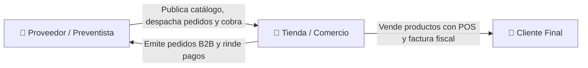
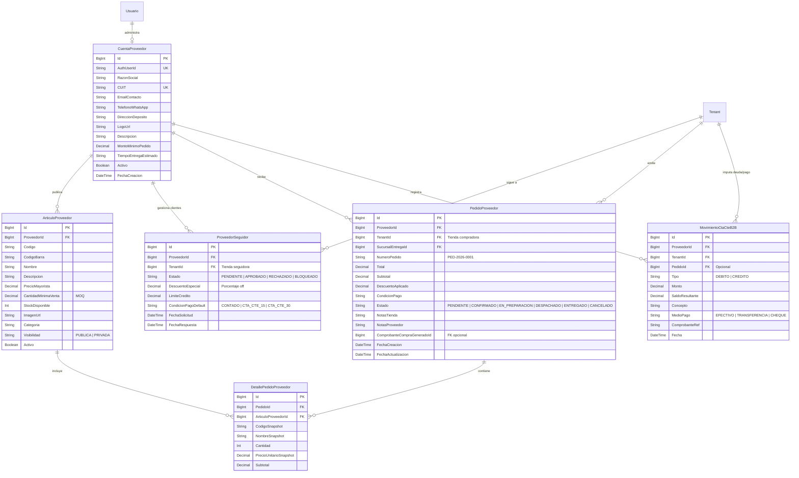
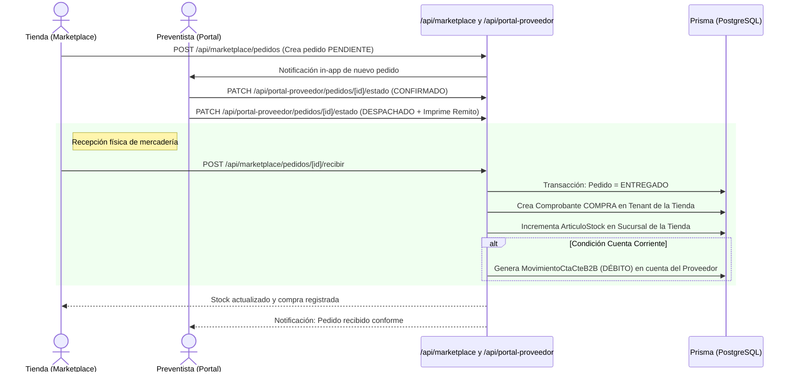

# 📦 Especificación Técnica (SDD): Portal de Proveedores / Preventistas y Marketplace B2B

| Metadato | Detalle |
|---|---|
| **Identificador** | `SPEC-PROV-001` |
| **Versión** | `1.1.0` |
| **Estado** | 🟡 **PROPUESTO / EN REVISIÓN** |
| **Fecha de actualización** | 2026-10-09 |
| **Módulos relacionados** | Compras, Stock, Notificaciones, Autenticación, Catálogo, Cuentas Corrientes |

---

## 1. Resumen Ejecutivo y Objetivos

### 1.1 Contexto y Problema
Actualmente, las Tiendas en PuntoX gestionan sus proveedores como registros locales pasivos y deben ingresar manualmente comprobantes de compra, costos y listas de precios cuando reciben mercadería. No existe un canal digital para que los distribuidores/proveedores publiquen sus catálogos, reciban pedidos directos ni coordinen cuentas corrientes con sus tiendas compradoras.

### 1.2 Solución Propuesta (Marketplace B2B y Portal del Preventista)
Integrar a los **Proveedores / Preventistas** como actores de primer nivel en la plataforma, cerrando el ciclo comercial completo:
1. **Los Clientes** compran en la **Tienda** (Punto de Venta / POS).
2. **Las Tiendas** exploran productos y emiten pedidos a los **Proveedores** (Marketplace B2B).
3. **Los Proveedores / Preventistas** operan desde un portal exclusivo (`/portal-proveedor`) con dashboard ejecutivo, catálogo público/privado, despacho de pedidos y control de cuentas corrientes B2B.



---

## 2. Secciones del Portal del Proveedor / Preventista (`/portal-proveedor/*`)

El portal cuenta con 6 secciones operativas especializadas:

```
Portal del Proveedor (/portal-proveedor)
├── 📊 1. Dashboard Ejecutivo         (/portal-proveedor/dashboard)
├── 📦 2. Catálogo de Artículos       (/portal-proveedor/catalogo)
├── 📑 3. Gestión de Pedidos B2B      (/portal-proveedor/pedidos)
├── 👥 4. Cartera de Tiendas/Clientes (/portal-proveedor/clientes)
├── 💰 5. Cuentas Corrientes B2B      (/portal-proveedor/cuentas-corrientes)
└── ⚙️ 6. Perfil y Configuración      (/portal-proveedor/perfil)
```

---

### 2.1 📊 Dashboard Ejecutivo (`/portal-proveedor/dashboard`)
Panel central con indicadores en tiempo real de la distribuidora:
- **KPIs Principales**:
  - Facturación acumulada del mes en curso y comparativa con el mes anterior.
  - Cantidad de pedidos en estado `PENDIENTE` de aprobación (con indicador de urgencia).
  - Total de tiendas vinculadas activas.
  - Saldo total pendiente de cobro en Cuentas Corrientes B2B.
- **Gráficos y Alertas**:
  - Gráfico de volumen de pedidos diarios/semanales.
  - Listado de pedidos prioritarios recién ingresados.
  - Alertas de productos propios con bajo stock en depósito.

---

### 2.2 📦 Catálogo de Artículos (`/portal-proveedor/catalogo`)
Gestión del catálogo mayorista y segmentación de visibilidad:
- **Datos del Artículo**: Código interno, código de barras (EAN), nombre, descripción, categoría y foto.
- **Condiciones Comerciales**:
  - Precio mayorista base.
  - Cantidad mínima de compra (**MOQ** - *Minimum Order Quantity*), ej. "Mínimo 6 unidades".
  - Stock disponible en depósito distribuidor (con opción de pausar venta si no hay stock).
- **Segmentación de Visibilidad**:
  - 🌐 **PÚBLICA**: Visible para todas las tiendas en el Marketplace general de PuntoX.
  - 🔒 **PRIVADA**: Visible únicamente para tiendas con relación de seguimiento **Aprobada**. Al publicar un producto privado u oferta, se envía automáticamente una notificación in-app a sus tiendas seguidoras.

---

### 2.3 📑 Gestión de Pedidos B2B (`/portal-proveedor/pedidos`)
Bandeja de procesamiento de órdenes de reposición emitidas por las tiendas:
- **Filtros por Estado**: `PENDIENTE` | `CONFIRMADO` | `EN_PREPARACION` | `DESPACHADO` | `ENTREGADO` | `CANCELADO`.
- **Detalle de la Orden**:
  - Tienda compradora, CUIT, teléfono de contacto y sucursal/dirección de entrega.
  - Desglose de ítems, cantidades solicitadas y precios pactados.
  - Notas u observaciones de la tienda.
- **Acciones del Preventista**:
  - Confirmar pedido o ajustar cantidades ante eventuales quiebres de stock.
  - Cambiar estado operativo (`En preparación` ➔ `Despachado`).
  - Imprimir **Remito de Entrega / Hoja de Ruta** para el chofer o preventista.

---

### 2.4 👥 Cartera de Tiendas y Clientes (`/portal-proveedor/clientes`)
Administración de la red de comercios vinculados:
- **Bandeja de Solicitudes**: Aprobación o rechazo de tiendas que solicitaron seguir al proveedor para acceder al catálogo privado.
- **Ficha Comercial por Tienda**:
  - Estado de la relación: `APROBADO` | `PENDIENTE` | `RECHAZADO` | `BLOQUEADO`.
  - **Descuento Comercial Especial**: Porcentaje de bonificación personalizado sobre lista para esa tienda específica (ej. 10% off).
  - **Condición de Pago Acordada**: Efectivo contra entrega, Transferencia anticipada, o Cuenta Corriente a 15/30 días con límite de crédito asignado.
  - Historial consolidado de pedidos de la tienda.

---

### 2.5 💰 Cuentas Corrientes y Cobranzas B2B (`/portal-proveedor/cuentas-corrientes`)
Control financiero del crédito otorgado a las tiendas:
- **Balance por Tienda**: Deuda actual, límite de crédito asignado y fecha del último pago.
- **Registro de Movimientos**:
  - **Débitos**: Generados automáticamente al despachar o entregar pedidos con condición "Cuenta Corriente".
  - **Créditos / Pagos**: Registro manual de cobranzas efectuadas por el preventista o recibidas por transferencia/cheque.
- **Comprobante de Cobro**: Registro con medio de pago (Efectivo, Transferencia, Cheque con fecha/banco) e imputación a pedidos pendientes.

---

### 2.6 ⚙️ Perfil Comercial y Configuración (`/portal-proveedor/perfil`)
Identidad y condiciones de venta de la distribuidora:
- Razón Social, CUIT, dirección del depósito central y logotipo.
- Canal de contacto directo (número de WhatsApp y email para atención de pedidos).
- **Monto Mínimo de Pedido Global** (ej. "$100.000 mínimo por orden").
- Tiempos de entrega estimados (ej. "Entrega en 24/48 hs hábiles").

---

## 3. Modelo de Datos (Prisma)



---

## 4. Flujo Integrado: Pedido ➔ Despacho ➔ Entrada a Stock



---

## 5. Contratos de API (Endpoints del Portal y Marketplace)

### 5.1 Endpoints del Portal de Proveedor (`/api/portal-proveedor/*`)

| Método | Endpoint | Permiso / Rol | Descripción |
|---|---|---|---|
| `GET` | `/api/portal-proveedor/dashboard` | `PROVEEDOR` | KPIs de facturación, pedidos urgentes, deuda total y métricas |
| `GET` | `/api/portal-proveedor/productos` | `PROVEEDOR` | Listado de catálogo propio (Público y Privado) |
| `POST` | `/api/portal-proveedor/productos` | `PROVEEDOR` | Alta de nuevo producto con visibilidad y MOQ |
| `PATCH` | `/api/portal-proveedor/productos/[id]` | `PROVEEDOR` | Edición de precios mayoristas, stock o visibilidad |
| `DELETE` | `/api/portal-proveedor/productos/[id]` | `PROVEEDOR` | Baja lógica de artículo |
| `GET` | `/api/portal-proveedor/pedidos` | `PROVEEDOR` | Bandeja de pedidos recibidos con filtros por estado |
| `PATCH` | `/api/portal-proveedor/pedidos/[id]/estado` | `PROVEEDOR` | Transición de estado (`CONFIRMADO`, `DESPACHADO`, etc.) |
| `GET` | `/api/portal-proveedor/seguidores` | `PROVEEDOR` | Cartera de tiendas y solicitudes pendientes |
| `PATCH` | `/api/portal-proveedor/seguidores/[id]` | `PROVEEDOR` | Aprobar/Rechazar y fijar descuento/límite de crédito |
| `GET` | `/api/portal-proveedor/cuentas-corrientes` | `PROVEEDOR` | Saldos y estados de cuenta de todas las tiendas |
| `POST` | `/api/portal-proveedor/cuentas-corrientes/cobros` | `PROVEEDOR` | Registro de cobro a una tienda (Efectivo/Transferencia/Cheque) |
| `GET/PATCH`| `/api/portal-proveedor/perfil` | `PROVEEDOR` | Datos comerciales, CUIT, WhatsApp y monto mínimo de orden |

### 5.2 Endpoints del Marketplace para Tiendas (`/api/marketplace/*`)

| Método | Endpoint | Permiso / Rol | Descripción |
|---|---|---|---|
| `GET` | `/api/marketplace/productos` | `COMPRAS_VER` | Catálogo B2B (Públicos + Privados de proveedores aprobados) |
| `GET` | `/api/marketplace/proveedores` | `COMPRAS_VER` | Directorio de distribuidores verificados y estado de seguimiento |
| `POST` | `/api/marketplace/proveedores/[id]/seguir` | `COMPRAS_CREAR` | Solicitar acceso al catálogo privado del distribuidor |
| `POST` | `/api/marketplace/pedidos` | `COMPRAS_CREAR` | Envío de pedido B2B a un proveedor |
| `GET` | `/api/marketplace/pedidos` | `COMPRAS_VER` | Historial de pedidos realizados y estados de despacho |
| `POST` | `/api/marketplace/pedidos/[id]/recibir` | `COMPRAS_CREAR` | Confirmar recepción ➔ genera Compra local e incrementa Stock |

---

## 6. Criterios de Aceptación (BDD / Gherkin)

```gherkin
Feature: Dashboard Ejecutivo del Proveedor
  Scenario: Preventista ingresa a su portal
    Given que estoy autenticado como usuario con rol "PROVEEDOR"
    When accedo a /portal-proveedor/dashboard
    Then visualizo mis métricas de facturación del mes
    And veo el conteo de pedidos pendientes de despacho
    And veo el saldo global pendiente de cobro en cuentas corrientes B2B

Feature: Cuenta Corriente B2B y Registro de Cobros
  Scenario: Preventista registra cobro de una tienda
    Given que la Tienda "Kiosco Central" tiene una deuda de $150.000 con el Proveedor
    When el preventista registra un cobro de $100.000 mediante "TRANSFERENCIA" con comprobante "TRF-8821"
    Then se genera un MovimientoCtaCteB2B de tipo "CREDITO" por $100.000
    And el nuevo saldo adeudado de la tienda pasa a ser $50.000

Feature: Aislamiento entre Proveedores
  Scenario: Proveedor no puede acceder a datos de otro distribuidor
    Given que estoy autenticado como Proveedor "Distribuidora Mayorista A"
    When intento consultar pedidos o clientes de "Distribuidora Mayorista B"
    Then el backend retorna error 403 Forbidden
```

---

## 7. Plan de Implementación por Fases

- [ ] **Fase 1: Modelo de Base de Datos y Schemas Zod**
  - [ ] Modelos Prisma: `CuentaProveedor`, `ArticuloProveedor`, `ProveedorSeguidor`, `PedidoProveedor`, `DetallePedidoProveedor`, `MovimientoCtaCteB2B`.
  - [ ] Migración Prisma.
  - [ ] Schemas Zod en `src/lib/validations/proveedor-portal.schema.ts`.

- [ ] **Fase 2: Layout y Navegación del Portal de Proveedor**
  - [ ] Rol `PROVEEDOR` en constantes y middleware.
  - [ ] Layout `/portal-proveedor` con sidebar exclusivo (Dashboard, Catálogo, Pedidos, Clientes, Cuentas Corrientes, Perfil).

- [ ] **Fase 3: Secciones del Portal del Proveedor**
  - [ ] Dashboard con tarjetas de KPIs y alertas de pedidos urgentes.
  - [ ] Catálogo de artículos con toggle Público/Privado y MOQ.
  - [ ] Gestión de pedidos B2B con cambios de estado e impresión de remitos.
  - [ ] Cartera de clientes con asignación de descuentos especiales.
  - [ ] Módulo de Cuentas Corrientes B2B y registro de cobranzas.

- [ ] **Fase 4: Marketplace B2B en el Dashboard de las Tiendas**
  - [ ] Pantalla `/compras/marketplace` con catálogo B2B, buscador y filtros.
  - [ ] Botón "Solicitar vínculo / Seguir".
  - [ ] Carrito B2B respetando MOQs y checkout de pedido.

- [ ] **Fase 5: Integración con Stock y Notificaciones**
  - [ ] Transacción automática de Pedido Entregado ➔ Comprobante Compra + `ArticuloStock`.
  - [ ] Notificaciones in-app de ofertas privadas y cambios de estado de despacho.

- [ ] **Fase 6: Testing Automatizado**
  - [ ] Tests unitarios en Vitest para aislamiento y cuentas corrientes B2B.
  - [ ] Spec E2E en Playwright para el ciclo completo Tienda-Proveedor.
