# Módulo: Caja y Gastos

El módulo de **Caja y Gastos** gestiona el ciclo operativo del dinero en efectivo y otros medios de pago dentro de cada sucursal de PuntoX: apertura y cierre de caja, registro de movimientos en tiempo real, control de turnos, arqueos, y administración de gastos operativos.

---

## 1. Conceptos Principales

- **Caja por Sucursal**: Cada sucursal física maneja su propia caja independiente. Un usuario no puede operar sobre la caja de una sucursal sin tener asignada esa sucursal.
- **Ciclo de Turno**:
  1. **Apertura de Caja**: Registro de fondo inicial en efectivo (`montoInicial`) con timestamp y empleado responsable.
  2. **Operación continua**: Registro automático de ingresos (ventas en efectivo, cobros de cuenta corriente) y egresos (gastos, retiros, vueltos de notas de crédito).
  3. **Cierre y Arqueo de Caja**: Conteo físico (`montoCierre`), cálculo automático del total teórico esperado por forma de pago, determinación de diferencias (sobrante/faltante) y cálculo de ganancia neta.
- **Gastos Operativos**: Egresos de dinero categorizados por **Conceptos de Gastos** (alquiler, servicios, insumos, sueldos) con soporte de múltiples formas de pago y comprobantes adjuntos.
- **Historial y Auditoría**: Trazabilidad completa de cajas cerradas con detalle de transacciones asociadas y resumen diario.

---

## 2. Modelo de Datos (Prisma)

```mermaid
erDiagram
    Sucursal ||--o{ Caja : "tiene"
    Usuario ||--o{ Caja : "abre/cierra"
    Caja ||--o{ Gasto : "registra"
    Caja ||--o{ Comprobante : "vincula"
    ConceptoGasto ||--o{ Gasto : "clasifica"
    
    Caja {
        BigInt Id PK
        BigInt TenantId FK
        BigInt SucursalId FK
        BigInt UsuarioId FK
        DateTime FechaApertura
        DateTime FechaCierre
        Decimal MontoInicial
        Decimal MontoFinal
        Decimal TotalVentasEfectivo
        Decimal TotalGastos
        Decimal GananciaEstimada
        String Estado "ABIERTA | CERRADA"
    }
    
    Gasto {
        BigInt Id PK
        BigInt TenantId FK
        BigInt SucursalId FK
        BigInt CajaId FK
        BigInt ConceptoGastoId FK
        Decimal Monto
        Int TipoPagoId
        String Descripcion
        DateTime Fecha
    }
    
    ConceptoGasto {
        BigInt Id PK
        BigInt TenantId FK
        String Nombre
        Boolean Activo
    }
```

---

## 3. Endpoints de API

| Método | Endpoint | Permiso requerido | Descripción |
|---|---|---|---|
| `GET` | `/api/caja` | `CAJA_VER` | Estado de la caja actual de la sucursal activa (`soloAbierta=true`) o listado filtrado |
| `POST` | `/api/caja` | `CAJA_GESTIONAR` | Apertura (`montoInicial`) o Cierre (`montoCierre`, `cajaId`) |
| `GET` | `/api/cajas` | `CAJA_VER` | Historial paginado de cajas anteriores por sucursal con filtros de fecha |
| `GET` | `/api/gastos` | `GASTOS_VER` | Listado paginado de gastos con filtros por concepto, fecha y sucursal |
| `POST` | `/api/gastos` | `GASTOS_GESTIONAR` | Registro de nuevo gasto (afecta caja abierta si el pago es en efectivo) |
| `PATCH` | `/api/gastos` | `GASTOS_GESTIONAR` | Edición de un gasto existente |
| `DELETE` | `/api/gastos?Id={id}` | `GASTOS_GESTIONAR` | Soft delete (`EstaEliminado: true`) de un gasto |
| `GET` | `/api/conceptos-gastos` | `GASTOS_VER` | Categorías de gastos configuradas en el tenant |
| `POST` | `/api/conceptos-gastos` | `GASTOS_GESTIONAR` | Crear nuevo concepto de gasto |

---

## 4. Validaciones y Reglas de Negocio

1. **Una sola caja abierta por sucursal**: No se permite abrir una nueva caja si ya existe una caja en estado `ABIERTA` para esa misma sucursal.
2. **Restricción de ventas sin caja**: Según la configuración de la tienda (`Configuracion.PermitirVenderSinCaja`), el sistema bloquea o advierte al intentar confirmar una venta en efectivo sin una caja abierta.
3. **Límite de montos**: Los montos de apertura, cierre y gastos se validan contra `MONTO_CAJA_MAX` (999.999.999.999) para prevenir desbordamientos numéricos.
4. **Cálculo de Ganancias (`calcularGananciaVentasCaja`)**:
   - `Ganancia = Total Ventas - Costo Mercadería Vendida - Gastos Operativos`.

---

## 5. Componentes Frontend

- **Página Principal**: `src/app/(dashboard)/caja/page.tsx`
- **Sub-rutas**:
  - `/caja/gastos`: Registro y listado de gastos con `GenericCrud`.
  - `/caja/cobros`: Ingresos por cobranzas de cuentas corrientes imputadas a caja.
  - `/caja/historial`: Consulta de cierres históricos y exportación.
- **Componentes clave**:
  - `CajaEstadoCard.tsx`: Indicador visual de estado (Abierta/Cerrada), saldo actual y botones de acción rápida.
  - `AperturaCajaModal.tsx`: Modal con validación Zod para ingreso de fondo inicial.
  - `CierreCajaModal.tsx`: Resumen de arqueo, desglose por forma de pago (Efectivo, Tarjetas, Transferencias, Cta Cte) y confirmación de cierre.
  - `GastoFormModal.tsx`: Formulario de registro con selector de concepto y medios de pago.

---

## 6. Testing

- **Tests unitarios de validación**: `src/test/validation/caja-validation.test.ts` y `gastos-validation.test.ts`.
- **E2E Playwright**: `e2e/journey/06-caja.spec.ts` (Fase 7: Apertura, transacciones, gastos, arqueo y cierre).
