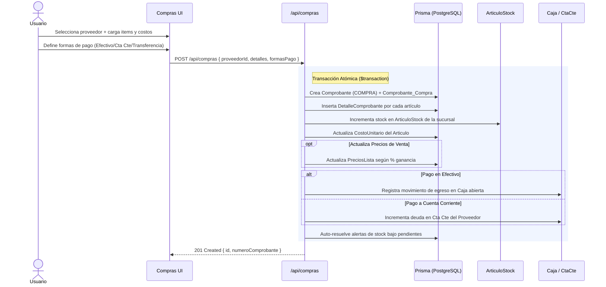

# Módulo: Compras y Recepción de Mercadería

El módulo de **Compras** gestiona la adquisición de mercaderías e insumos a proveedores, permitiendo el ingreso físico de stock, la actualización de costos unitarios y listas de precios de venta, y la registración de pasivos o egresos de dinero.

---

## 1. Flujo Operativo de una Compra

---

## 2. Modelo de Datos (Prisma)

- **`Comprobante`**: Registro cabecera (`TipoComprobante: COMPRA`, `Total`, `SubTotal`, `Iva`, `Fecha`).
- **`Comprobante_Compra`**: Relación 1:1 con `Comprobante` que vincula el `ProveedorId`.
- **`DetalleComprobante`**: Líneas de artículos (`ArticuloId`, `Cantidad`, `PrecioUnitario` / Costo, `Subtotal`).
- **`ArticuloStock`**: Registro de existencias (`CantidadStock`) por cada combinación de `(ArticuloId, SucursalId)`.
- **`Precio`**: Precios de venta asociados a las distintas listas de precios del comercio.

---

## 3. Endpoints de API

| Método | Endpoint | Permiso requerido | Descripción |
|---|---|---|---|
| `POST` | `/api/compras` | `COMPRAS_CREAR` | Registra una nueva compra, incrementa stock y ajusta costos |
| `GET` | `/api/compras` | `COMPRAS_VER` | Listado histórico de comprobantes de compra con filtros por proveedor y fecha |
| `GET` | `/api/compras/[id]` | `COMPRAS_VER` | Detalle completo de una compra y sus ítems |

---

## 4. Validaciones y Reglas de Negocio

1. **Aislamiento Multi-Sucursal**: El stock ingresado se asigna automáticamente a la sucursal activa en la sesión del usuario operador.
2. **Cálculo de Precios de Lista**: Si se envían `preciosListaActualizados`, el sistema recalcula los precios finales de venta en base al nuevo costo y el margen configurado.
3. **Múltiples Formas de Pago**: La suma de los montos en `formasPago` debe coincidir exactamente con el total del comprobante.
4. **Auto-resolución de Notificaciones**: Al aumentar el stock, el sistema ejecuta `resolveStockNotifications()` para resolver automáticamente notificaciones de stock bajo si la cantidad supera el `StockMinimo`.

---

## 5. Componentes Frontend

- **Ruta**: `src/app/(dashboard)/compras/page.tsx`
- **Componentes**:
  - `CompraForm.tsx`: Formulario de recepción de mercadería con buscador de productos y sugerencia de costo anterior.
  - `DetalleCompraTable.tsx`: Grilla editable de cantidades, costos e impacto en precios de venta.
  - `FormasPagoCompraModal.tsx`: Distribución de importes entre caja y cuenta corriente.

---

## 6. Testing

- **E2E Playwright**: `e2e/journey/08-compras.spec.ts` (Fase 9: Alta de compras, actualización de stock y validación de costos).
