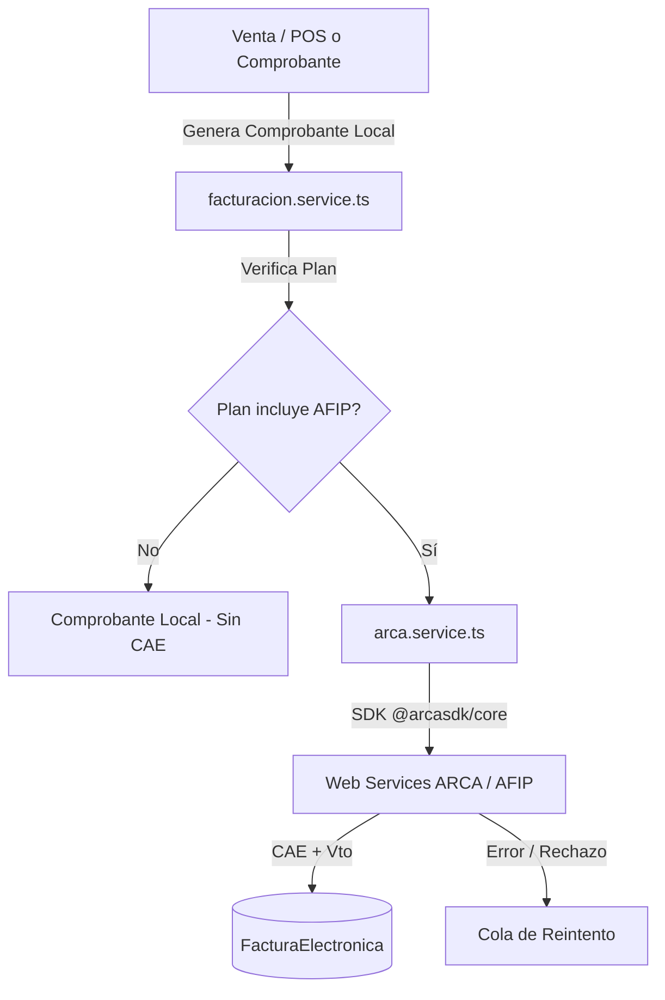

# Módulo: Facturación Electrónica (AFIP / ARCA)

El módulo de **Facturación Electrónica** integra a PuntoX con los servicios web de **ARCA (ex AFIP)** mediante Web Services (WSFE), permitiendo la autorización fiscal de comprobantes (Facturas A, B, C y Notas de Crédito A, B, C) para la obtención del **CAE (Código de Autorización Electrónico)**.

---

## 1. Arquitectura de Integración

---

## 2. Tipos de Comprobantes Soportados

| Tipo Local | Código AFIP | Descripción | Requiere Comprobante Asociado |
|---|---|---|---|
| `1` | `1` | Factura A | No |
| `2` | `6` | Factura B | No |
| `3` | `11` | Factura C | No |
| `6` (NC de Factura A) | `3` | Nota de Crédito A | Sí (`CbtesAsoc`: Factura A original) |
| `6` (NC de Factura B) | `8` | Nota de Crédito B | Sí (`CbtesAsoc`: Factura B original) |
| `6` (NC de Factura C) | `13` | Nota de Crédito C | Sí (`CbtesAsoc`: Factura C original) |

---

## 3. Modelo de Datos (Prisma)

- **`FacturaElectronica`**:
  - `Id`, `TenantId`, `ComprobanteId` (FK 1:1)
  - `PuntoVenta`: Número de punto de venta habilitado en ARCA.
  - `CbteTipo`: Código fiscal del comprobante según AFIP.
  - `CbteNumero`: Número correlativo asignado por ARCA.
  - `CAE`: Código alfanumérico devuelto por AFIP.
  - `CAEFechaVto`: Fecha límite de validez del CAE.
  - `Estado`: `AUTORIZADO | RECHAZADO | ERROR_CONEXION | PENDIENTE`.
  - `Observaciones` / `Resultado`: Mensajes descriptivos o códigos de error devueltos por el Web Service.
- **Configuración Fiscal en `Tenant`**:
  - `Cuit`, `CertificadoAfip` (.crt encriptado), `ClavePrivadaAfip` (.key encriptada), `PuntoVentaDefault`, `Ambiente` (Homologación / Producción).

---

## 4. Flujo de Autorización y Manejo de Errores

1. **Creación previa del comprobante local**: La transacción se guarda en la base de datos con numeración interna antes de invocar a AFIP.
2. **Validación de Plan SaaS**: Si el plan del tenant no tiene `incluyeAFIP: true` (ej. Plan Básico), se omite la llamada y el comprobante queda registrado localmente.
3. **Puntos de Venta por Sucursal**: Si la sucursal tiene asignado un `PuntoVentaAfip` específico, se utiliza este; en su defecto se usa el default del tenant.
4. **Reintentos en Lote (`bulk-reprocesar`)**: En caso de cortes de servicio de ARCA, los comprobantes en estado `ERROR_CONEXION` o `PENDIENTE` pueden reprocesarse de forma masiva desde la pantalla de comprobantes.

---

## 5. Endpoints de API

| Método | Endpoint | Permiso requerido | Descripción |
|---|---|---|---|
| `POST` | `/api/facturacion/electronica/[id]` | `COMPROBANTES_CREAR` | Reintenta la autorización fiscal individual de un comprobante |
| `POST` | `/api/facturacion/electronica/bulk-reprocesar` | `COMPROBANTES_CREAR` | Reprocesa en lote comprobantes pendientes o con fallos de conexión |
| `GET` | `/api/configuracion/fiscal` | `CONFIGURACION_VER` | Consulta de CUIT, certificados y puntos de venta configurados |

---

## 6. Documentación Relacionada

- [Especificación de Notas de Crédito AFIP](../features/nota-credito-afip.md)
- [Definición de Planes SaaS y Feature Gating](../saas/planes-saas.md)
- [Módulo de Ventas y Comprobantes](ventas.md)
