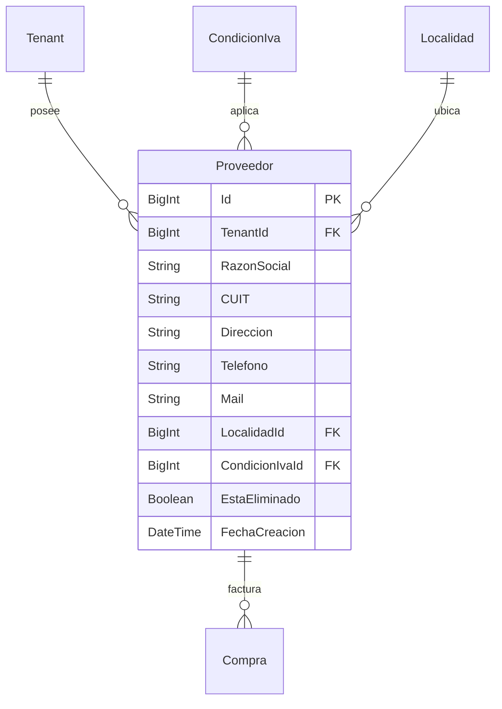

# Módulo: Proveedores y Cuentas Corrientes

El módulo de **Proveedores** administra la base de datos de proveedores de la tienda, sus datos fiscales, información de contacto, y el historial de compras y pagos a través de sus cuentas corrientes.

---

## 1. Conceptos Principales

- **Gestión de Proveedores**: Alta, edición, baja lógica (`EstaEliminado: true`) y restauración de proveedores comerciales.
- **Datos Fiscales**: Asociación con Condición de IVA (Responsable Inscripto, Monotributo, Exento) y CUIT con validación de formato.
- **Cuenta Corriente de Proveedores**:
  - **Débitos**: Generados automáticamente al asentar facturas de compra a crédito.
  - **Créditos**: Generados al registrar pagos a proveedores (efectivo, transferencias, cheques).
  - **Saldo**: Refleja la deuda acumulada pendiente de cancelación.
- **Búsqueda Indexada**: Filtros rápidos por Razón Social, CUIT o Email.

---

## 2. Modelo de Datos (Prisma)

---

## 3. Endpoints de API

| Método | Endpoint | Permiso requerido | Descripción |
|---|---|---|---|
| `GET` | `/api/proveedores` | `PROVEEDORES_VER` | Listado paginado con búsqueda (`?q=`) y filtro (`?incluirInactivos=true`) |
| `POST` | `/api/proveedores` | `PROVEEDORES_CREAR` | Alta de nuevo proveedor con validación Zod |
| `PATCH` | `/api/proveedores` | `PROVEEDORES_EDITAR` | Actualización de datos de proveedor |
| `DELETE` | `/api/proveedores?Id={id}` | `PROVEEDORES_ELIMINAR` | Baja lógica (o física si no tiene transacciones asociadas) |

---

## 4. Validaciones y Schemas (Zod)

Ubicación: `src/lib/validations/proveedor.schema.ts`

- **Razón Social**: Obligatoria, mínimo 2 caracteres, máximo 150 caracteres.
- **CUIT**: Validado contra expresión regular de 11 dígitos numéricos sin guiones.
- **Email**: Opcional, con formato de correo electrónico válido.
- **Condición de IVA**: Id de clave foránea obligatorio.

---

## 5. Componentes Frontend

- **Página Principal**: `src/app/(dashboard)/proveedores/page.tsx`
- **Componentes**:
  - `ProveedoresTable.tsx`: Implementación basada en `GenericCrud` y `GenericTable`.
  - `ProveedorFormModal.tsx`: Modal unificado para creación y edición de datos de proveedor.
  - Exportación: Soporte para exportar listados a CSV y XLS desde "Más opciones" o selección masiva.

---

## 6. Testing

- **E2E Playwright**: `e2e/journey/05-proveedores.spec.ts` (Fase 6: CRUD de proveedores, filtros, validaciones y cuenta corriente).
